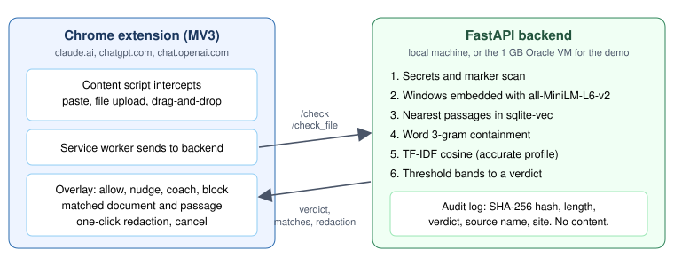
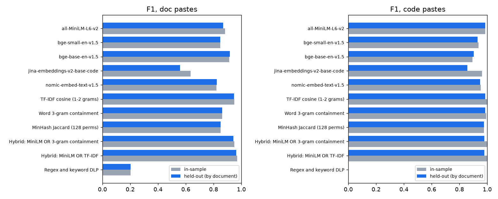
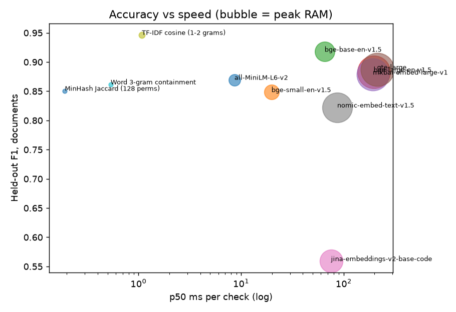
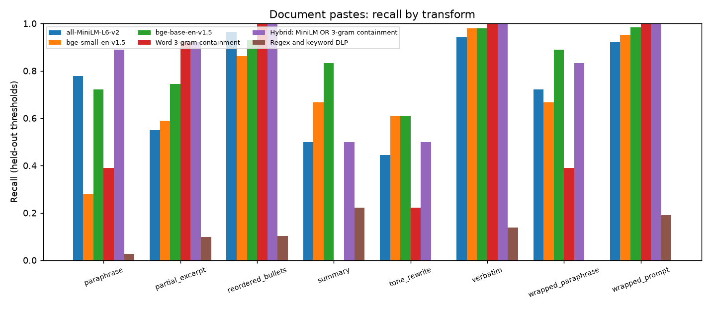
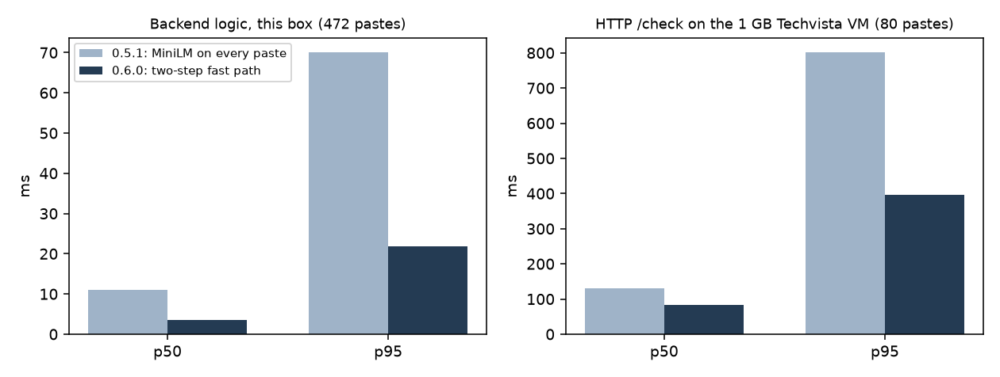
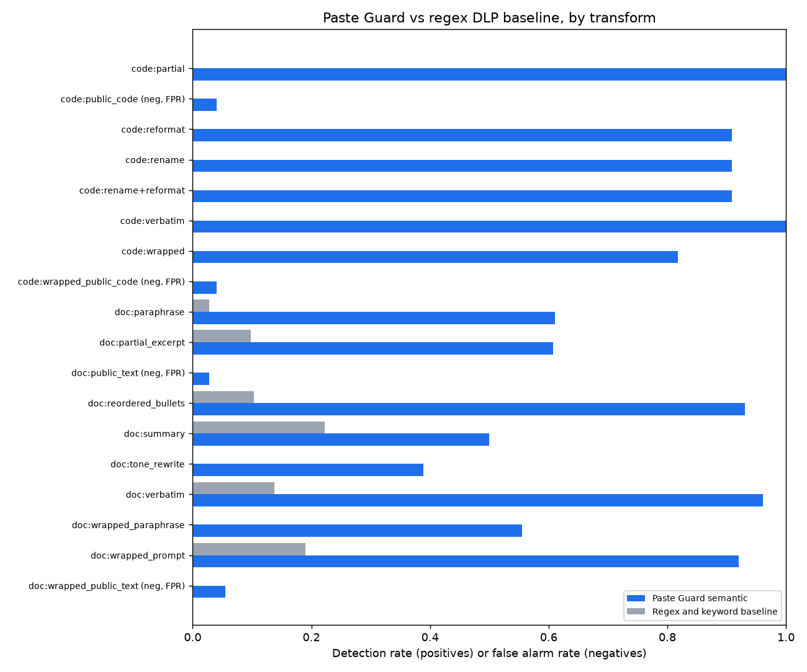

# Paste Guard

Checking what gets pasted into AI chat tools against a company's own documents and code

Sandeep Paluru 14 October 2026. Version 0.6.0. Repo: github.com/sandeep-paluru/paste-guard

## Summary

Paste Guard is a Chrome extension plus a small backend. When someone pastes text, uploads a file or drops a file into Claude or ChatGPT, it checks the content against the company's own documents and code, then answers allow, nudge, coach or block. It shows which document matched and which passage, and offers one-click redaction.

Nothing is trained. It uses a public pretrained embedding model (all-MiniLM-L6-v2) as-is, next to two cheap lexical checks. The only things I fitted to my data are the thresholds, and I report accuracy on documents the thresholds were never tuned on.

| | Fast profile (previous default) | Accurate profile (default since v0.5.1) | Accurate with two-step fast path (v0.6.0) |
|---|---|---|---|
| Signals for documents | MiniLM OR word 3-gram | MiniLM OR word 3-gram OR TF-IDF | same, MiniLM skipped when not needed |
| Held-out document F1 | 0.943 | 0.966 | same thresholds, not re-tuned |
| Held-out recall / precision | 0.90 / 0.99 | 0.94 / 0.99 | recall 0.946 on all 472 pastes, same as without |
| False alarms on document negatives | 2.8% | 2.8% (2 of 72) | 2.5% on all 472 pastes, same as without |
| Full /check request, p50 / p95 (8 CPU box) | 16 ms / 58 ms | 19 ms / 56 ms | 7 ms / 22 ms |
| Regex and keyword baseline, document F1 | 0.20 | 0.20 | 0.20 |

Latency figures are from my 8 vCPU machine. On the 1 GB VM the fast profile ran at p50 208 ms and p95 995 ms. In 0.6.0 the accurate profile on the VM went from p50 131 ms and p95 802 ms to p50 84 ms and p95 397 ms (more on that under limitations).

## The problem

A common way confidential text leaves a company: someone has a document, wants a quick summary, and pastes it or drops the file into a chat site. The useful question at that moment is whether the content is the company's, not only whether it looks sensitive. People rarely paste a document with "CONFIDENTIAL" on top. They paste a paragraph, reword it, trim it, or wrap it in "summarize this for me". Paste Guard checks that locally, and the eval shows where the approach holds and where it breaks.

## The gap it targets

**Regex and keyword DLP.** Rules for secrets, card numbers and "CONFIDENTIAL" banners are useful, and Paste Guard keeps them for secrets. But on my eval set a regex and keyword baseline (secrets rules, confidentiality markers and a sensitive business keyword list) caught 11% of confidential document pastes and none of the code pastes. It caught 3% of paraphrases.

**Category classifiers.** From what I could find publicly, most tools in this space (WASViking, Harmonic, LayerX, Nightfall and others) label content by type: PII, secrets, source code, legal text. That tells you a paste looks like a legal document. It does not tell you that it is paragraph three of your own acquisition memo, and it cannot name the source.

**Fingerprinting and lineage.** Document fingerprinting and exact data match handle verbatim and lightly edited copies but are weak on paraphrase. Microsoft's documentation for Purview's paste-to-browser control says it does not support exact data match or document fingerprinting on paste at all. Cyberhaven tracks where data came from, which misses text that was retyped or copied from somewhere its agent does not see.

**Where Paste Guard sits.** It matches each paste against an index of the company's own documents and code, locally, and catches rewording as well as copies. A strong match to a board memo is a different event from someone pasting a public article.

## Architecture

**Extension (Chrome, Manifest V3).** A content script on claude.ai, chatgpt.com and chat.openai.com intercepts three things: paste, file picker uploads and drag-and-drop. Text files (.txt, .md) are read in the browser. PDF and DOCX files go to the backend for text extraction. The service worker sends the content to the backend and the overlay shows the verdict, the matched document, the matched passage and a redaction button. The toolbar icon shows a green dot when protection is on, and the settings page allows a per-site pause.

**Backend (FastAPI).** It runs on the same machine or a company server. It has also been run on a 2 vCPU, 1 GB Oracle VM that also hosts my existing Techvista services. Each check does the following:

1. Secrets and marker scan. Cloud keys, API keys for the common providers (Anthropic, OpenAI, GitHub, Google, Stripe, Slack, Hugging Face and others), private keys and database URLs with a password are always blocked. JWTs and password assignments are coached.
2. The paste is cut into windows. Since 0.6.0, steps 4 and 5 run first and the embedding is skipped when it cannot change the verdict. Each window is otherwise embedded with all-MiniLM-L6-v2 (ONNX on CPU through fastembed).
3. Nearest passages are found in a sqlite-vec index of documents and code.
4. Word 3-gram containment is computed: the share of the window's 3-word sequences that appear in one indexed passage.
5. In the accurate profile, a TF-IDF cosine check (word 1 and 2 grams) also runs for documents.
6. Per-kind threshold bands turn the scores into allow, nudge, coach or block, plus the matches and a redacted version.

**Indexing.** Documents are split on paragraph boundaries into 120 to 200 word chunks with overlap, plus shorter 60 word passages so a short excerpt still has a close neighbour. The demo index has 485 document passages and 109 code chunks. `./pasteguard reindex` rebuilds it and the running server picks up the change.

**Redaction.** Headings and code signatures are kept, and each removed block becomes `[REDACTED: matches <source> paragraphs a-b]` (or `lines a-b` for code), so the AI tool still gets the structure of the question.

**Privacy.** Paste text is processed in memory and never written to disk. The model is downloaded once and then runs offline. The verdict log behind the admin page stores only a SHA-256 hash, the length, the verdict, the matched source name and the site, kept for 30 days. The admin page is served only to local connections.

## The data

All of it is synthetic. I wrote a corpus of 18 confidential documents for a fictional company, Calloway Metrics: board memos, an M&A term sheet, a layoff plan, compensation bands, pricing, a customer list with contract values, a security incident postmortem, a legal settlement summary, a product roadmap and similar, in .md, .txt, .pdf and .docx. The code side is one real open source Python repository standing in for a company repo.

The eval set has 472 labelled pastes:

| Set | Positives | Negatives |
|---|---|---|
| Documents (356) | 284 in 8 paste types | 72: public business text, alone (36) and wrapped in a prompt (36) |
| Code (116) | 66 in 6 paste types | 50: public code, alone (25) and wrapped in a prompt (25) |

Document paste types: verbatim (51), partial excerpt (51), paraphrase (36), reordered bullets (29), summary (18), tone rewrite (18), paraphrase wrapped in a prompt (18) and text wrapped in a prompt such as "summarise this for me" (63). Code paste types, 11 each: verbatim, partial, renamed, reformatted, renamed and reformatted, and wrapped in a prompt.

## What "the model" is, and how I measured it

To be clear up front: **I did not train or fine-tune any model.** Matching uses `sentence-transformers/all-MiniLM-L6-v2`, a public pretrained sentence embedding model (384 dimensions, 91 MB as ONNX), used zero-shot. The 3-gram and TF-IDF checks are not learned at all, apart from TF-IDF's vocabulary and IDF weights, which come from the indexed corpus. No eval text was ever used as training data.

What I did tune is the thresholds. Each sweep scans 0.40 to 0.95 in 0.01 steps and keeps the best F1 with false alarms at or below 3% (5% before v0.5). Tuning and scoring on the same samples flatters the result, so the benchmark uses a **held-out split by document**: the 18 documents are split into two halves of 9, thresholds are tuned on pastes from one half and scored on pastes from the other, then the halves swap. Code is split by source file. The gap between in-sample and held-out turned out small (1 to 3 points of F1), so the thresholds are not memorising particular documents. It does not tell me whether another company's documents land in the same similarity range. That needs a second corpus.

## Why MiniLM

I benchmarked eight pretrained embedding models, three non-neural baselines and a set of hybrids on the same paste windows and index. The rules were a full check p95 under 100 ms on a normal CPU and false alarms at most 3%. Held-out document results (latency is scoring only, on my machine, 2 threads):

| Method | F1 | Recall | False alarms | Summary recall | p50 | p95 | Meets both rules |
|---|---|---|---|---|---|---|---|
| all-MiniLM-L6-v2 | 0.870 | 0.77 | 2.8% | 0.50 | 9 ms | 65 ms | yes |
| bge-small-en-v1.5 | 0.848 | 0.74 | 1.4% | 0.67 | 20 ms | 144 ms | no |
| bge-base-en-v1.5 | 0.918 | 0.86 | 6.9% | 0.83 | 65 ms | 474 ms | no |
| bge-large-en-v1.5 | 0.883 | 0.80 | 2.8% | 0.72 | 196 ms | 1159 ms | no |
| mxbai-embed-large-v1 | 0.878 | 0.79 | 2.8% | 0.72 | 192 ms | 1305 ms | no |
| gte-large | 0.887 | 0.80 | 2.8% | 0.83 | 212 ms | 1339 ms | no |
| jina-embeddings-v2-base-code | 0.559 | 0.39 | 2.8% | 0.28 | 75 ms | 433 ms | no |
| nomic-embed-text-v1.5 | 0.822 | 0.71 | 5.6% | 0.33 | 87 ms | 590 ms | no |
| TF-IDF cosine (1-2 grams) | 0.946 | 0.90 | 1.4% | 0.28 | 1 ms | 2 ms | yes |
| Word 3-gram containment | 0.862 | 0.76 | 0.0% | 0.00 | 1 ms | 2 ms | yes |
| MinHash Jaccard | 0.851 | 0.74 | 1.4% | 0.06 | 0 ms | 1 ms | yes |
| MiniLM OR 3-gram (fast) | 0.943 | 0.90 | 2.8% | 0.50 | 9 ms | 67 ms | yes |
| MiniLM OR TF-IDF | 0.964 | 0.94 | 4.2% | 0.56 | 10 ms | 66 ms | no |
| bge-base OR 3-gram OR TF-IDF | 0.970 | 0.96 | 8.3% | 0.78 | 67 ms | 478 ms | no |
| mxbai-large OR 3-gram OR TF-IDF | 0.971 | 0.95 | 2.8% | 0.78 | 194 ms | 1309 ms | no |
| **MiniLM OR 3-gram OR TF-IDF (accurate)** | **0.966** | **0.94** | **2.8%** | **0.56** | **10 ms** | **69 ms** | **yes** |

What I took from it:

- **Bigger is not better here.** The large models (bge-large, mxbai-large, gte-large) reach held-out F1 of 0.88 to 0.89, barely above MiniLM's 0.87, at about 200 ms p50, over 1 second p95 and about 4 GB of RAM. They help on summaries (0.72 to 0.83 against 0.50), but not enough to justify 20 times the latency.
- **bge-base fails on false alarms, not just speed.** It has the best raw recall, but flags 7% to 8% of held-out negatives, mostly public text wrapped in a prompt (14% flagged). Making it faster would not fix that.
- **The code-specialised model is a poor fit.** jina code is worst on prose (0.56) and no better than MiniLM on code.
- **MiniLM fits the box.** 91 MB on disk, 0.4 s to load, 18 s to index all 594 chunks, and the full backend with the fast hybrid used 280 MB of RAM on my machine. bge-base needs 1.4 GB, which does not fit the 1 GB VM.
- **Lexical methods are strong on this data, and that needs a caveat.** TF-IDF alone beats every embedding model, because most of my leaked text keeps names, figures and product terms, exactly what TF-IDF weights. Lexical methods fail on summaries (3-gram 0.00, TF-IDF 0.28). That is where the embedding earns its place.

## The v0.5 accurate profile

Once RAM stopped being the constraint (backend on a desktop instead of the VM), I asked what the most accurate setup is that still meets both rules. The answer was MiniLM OR 3-gram OR TF-IDF. The three signals cover different kinds of paste: MiniLM covers meaning (paraphrase, summary), 3-gram covers exact excerpts, and TF-IDF covers rewording that keeps the rare words.

Held-out documents: **F1 0.966, recall 0.94, precision 0.99, false alarms 2.8% (2 of 72)**, against 0.943, 0.90, 0.99 and 2.8% for the fast profile. Tone rewrites go from 0.50 to 0.72 and summaries from 0.50 to 0.56. Over 120 real /check requests over HTTP on my machine (8 vCPU, 2 threads) it measured **p50 19 ms and p95 56 ms**, with the backend at 379 MB. It uses the same model and index as the fast profile, so switching needs no reindex. Since v0.5.1 it is the default; the old setup is `profile = "fast"` or `PG_PROFILE=fast`. TF-IDF is turned off for code in this profile, because on code it added false alarms (6% held-out on 50 negatives) without adding recall, which was already 1.00.

## The 0.6 fast path

The accurate profile spends most of its time in the MiniLM embedding, and many pastes share almost no vocabulary with any indexed document. I took the idea from Google DeepMind's on-device Gemma scam detector (October 2026): run a cheap classifier first and the heavier model only when needed. In 0.6.0, 3-gram containment and TF-IDF run on every window first, which takes a few ms. MiniLM is skipped when a cheap check already reaches block (the embedding cannot raise the verdict past block, so the outcome is identical), or when the best TF-IDF score against any indexed passage is below 0.10. I picked 0.10 because on the eval no positive with a MiniLM score of 0.60 or more has TF-IDF below 0.12, in either held-out fold. `PG_FAST_PATH=0` turns it off.

On all 472 eval pastes, with it off and on, recall is 0.946 and the false alarm rate 2.5% both ways. In-process p50 goes from 11.0 ms to 3.6 ms and p95 from 70.1 ms to 21.9 ms. MiniLM was skipped on 58.5% of the pastes. One verdict of 472 changed: a negative went from nudge to allow. Over HTTP on my 8 CPU machine p50 went from 19.1 ms to 7.3 ms and p95 from 56.1 ms to 22.5 ms. On the Techvista VM p50 went from 130.6 ms to 84.0 ms and p95 from 801.9 ms to 397.2 ms; the VM tail is memory pressure and swap, not the model. The eval set is mostly near-matches, so in daily use, where most pastes are unrelated text, the skip rate should be higher, but I did not measure that.

Two smaller changes. The backend now loads the model and runs one warm-up check at startup, so the first check after a restart takes 0.024 s on my machine instead of 1.29 s, and about 0.18 s on the VM instead of about 8.5 s. And the secrets scanner covers many more credential formats, with 84 pytest tests in total now. I also tried int8 quantization of MiniLM and dropped it: the model shrank from 90 MB to 23 MB and ran about 3 ms faster per text, but the embeddings drifted (cosine to the fp32 vectors averaged 0.952, as low as 0.888), more than the gap between the coach and block bands. The fast path already saves more than that without touching the thresholds.

## How the numbers moved

Every number in this section comes from a committed results file or the benchmark script, which can be re-run.

| Step | Change | Document result at coach level |
|---|---|---|
| 1 | Embedding model and sqlite-vec index, code only | n/a |
| 2 | Documents added: 12 docs, paragraph-aware chunks plus 60 word passages, 280 samples | P 0.98, R 0.82, F1 0.89, FPR 0.03 |
| 3 | Corpus grown to 18 longer, more varied documents, harder eval set (356 samples), thresholds retuned | P 0.99, R 0.75, F1 0.85, FPR 0.04 |
| 4 | Chunking bug fixed (the same 30 words could appear up to three times in a chunk) | P 0.99, R 0.80, F1 0.88, FPR 0.03 |
| 5 (v0.4) | Hybrid matching, MiniLM OR 3-gram, separated threshold bands | P 1.00, R 0.87, F1 0.93, FPR 0.01 (in-sample) |
| 6 (v0.4) | Held-out split by document added | Hybrid F1 0.94, R 0.90, FPR 0.03 |
| 7 (v0.5) | False alarm budget tightened to 3%, accurate profile | F1 0.966, R 0.94, FPR 0.028 |

Step 3 lowered the numbers on purpose. The bigger corpus and harder eval set are closer to reality, and the earlier 0.82 recall was on an easier set.

**A correction on short passages.** Adding the 60 word passages next to the long chunks is the largest single gain I found. A short excerpt or a one-paragraph summary has no close neighbour among 160 word chunks, because the rest of the chunk dilutes its vector. At one point I summarised this gain as "30% to 80%". When I went back to check, no recorded run supported that figure. The measured result is **51% to 80% recall at a fixed threshold of 0.63**, or 69% to 80% when each index gets its own best threshold. I corrected it in the log, and the measured figure is the one I stand behind.

**Threshold bands.** v0.3 shipped document bands of nudge 0.62 and coach 0.63, one hundredth apart, so nudge almost never fired on its own. In v0.4 I read the bands off the score distribution: nudge 0.58 (a soft "double check", recall 0.89 but FPR 0.13 in-sample), coach 0.64 (the best-F1 point) and block 0.74 (above every negative I have seen). The 3-gram bands are coach 0.25 and block 0.50. The best tuned value was 0.14, but the highest negative scored 0.13, so I left a margin. Code bands are 0.55, 0.65 and 0.85.

In-sample, the top match named the right source document 98% of the time (314 detected positives). On held-out thresholds the v0.4 hybrid named the right one 93% of the time (255 detected).

## Live test on the chat sites

Beyond the offline eval, I ran it by hand on chatgpt.com and claude.ai:

| Test | Result |
|---|---|
| Verbatim paste of a confidential document | Blocked |
| Paraphrased paste of a confidential document | Blocked |
| Paste of code from the company repo | Coached |
| One-click redaction | Works |
| Cancel from the overlay | Works |
| Normal, unrelated text | Allowed through |
| PDF upload of a confidential document | Blocked |
| Drag-and-drop of a file | Not tested yet |

Drag-and-drop is implemented in the extension, but I have not checked it end to end in either site, so I am not counting it as working.

## Limitations

- **Summaries are the weak spot.** Even the accurate profile catches 56% of summaries. A summary shares meaning with the source but few specific phrases.
- **The negative set is small and easy.** There are 72 document negatives, so one false alarm moves the rate by 1.4 points. 2.8% against 4.2% is a one-sample difference. The negatives are also public text and public code, not same-topic internal text that is not confidential, so the false alarm rates are optimistic for a real company. The strong lexical results could partly be an effect of these easy negatives.
- **Timing is from my machine.** The 16 to 19 ms p50 and 56 to 58 ms p95 figures are on an 8 vCPU desktop CPU, and 7 ms and 22 ms with the 0.6 fast path. On the shared 1 GB VM the fast profile measured p50 208 ms and p95 995 ms, and the accurate profile with the fast path p50 84 ms and p95 397 ms. With about 130 MB free next to the other services, part of the process gets paged out, and that drives the p95; a normal laptop meets p95 under 100 ms. The model now loads and warms up at startup (18 s on the VM), so the first check after a restart takes about 0.18 s there instead of about 8.5 s.
- **One synthetic company.** The corpus and the eval pastes are for one fictional company, Calloway Metrics. Real documents may land in a different similarity range.
- **Coverage.** Chrome only, on the sites in `paste-guard.toml`. Not desktop apps, browser agents inside those sites, mobile, or text typed in by hand.

## Next steps

1. Build harder negatives: same-topic internal text that is not confidential. That is the real test of the false alarm rate and of whether the lexical gains hold.
2. Run it on a second corpus, ideally a design partner's redacted documents, and report recall at a fixed low false alarm rate.
3. Work on summaries: a summary-level embedding of each document, and a small reranker or local LLM judge only on borderline scores, so the fast path stays fast.
4. Test drag-and-drop end to end in both sites.
5. Fix the rest of the VM tail by giving the backend its own memory, then re-measure p95 there. The fast path brought it from 802 ms to 397 ms, still over 100 ms.
6. Scope the cases the extension cannot see (desktop apps, agentic browsers) as a separate feasibility question.

Sources: README.md, docs/OPTIMIZATION_LOG.md, eval/benchmarks.md, eval/results.md, CHANGELOG.md and paste-guard.toml in the repo. Market and competitor notes are from public vendor pages and documentation.

